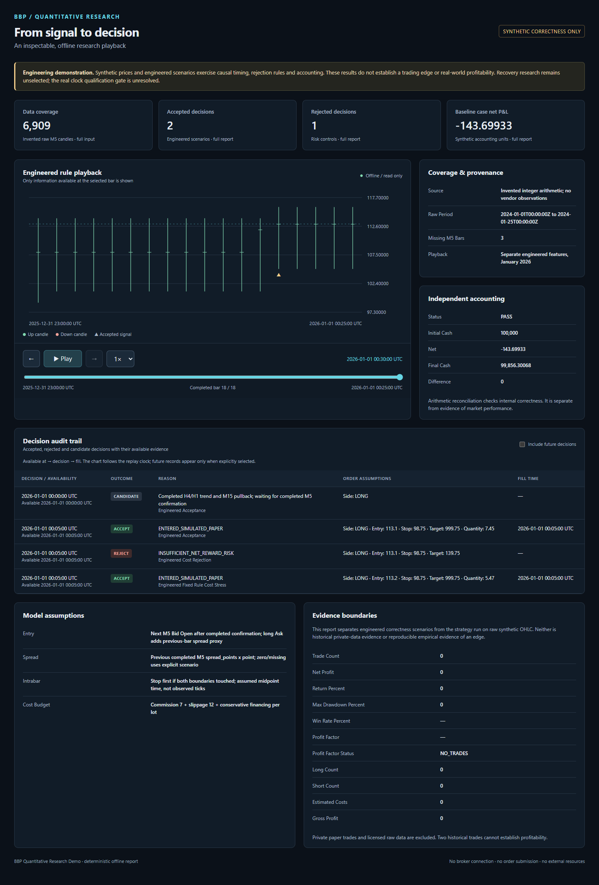

# BBP Quantitative Research Demo

An offline Python research demo that makes data availability, strategy decisions, trading costs and risk limits inspectable. A separate Decimal calculation reconciles simulated cash.

**All included candles, features and trades are synthetic. These results do not establish a trading edge.**

The raw candle replay retains its zero-trade outcome. A separate engineered feature case shows an accepted losing trade and a target rejected after costs. Its indicators and pivots are stipulated inputs, rather than features calculated from the illustration candles. See the [results](examples/report/report.md) and [playback](examples/report/dashboard.html).



## Run in five minutes

Use CPython **3.12.14** (reference runtime) or **3.14.8** (Windows compatibility runtime). Runtime, tests and playback use the standard library. No installation, broker terminal, credentials or network access is required. A source ZIP works without Git metadata.

```sh
python scripts/check.py
python run.py report --out build/report
python scripts/verify_release.py
```

The report command writes `report.json`, `report.md` and self-contained `dashboard.html`. Open the HTML directly, or start the optional guarded local server:

```sh
python run.py dashboard --report build/report/report.json
```

Open the printed loopback address, then use the play, step and slider controls. The server accepts reads only and validates Host, Origin and API tokens. Stop it with Ctrl+C. See [reproduction](docs/REPRODUCTION.md) for optional virtual environments, wheel installation and troubleshooting.

## What a reviewer can inspect

- 6,909 invented M5 candles over 24 days, three deliberately missing bars, complete H4/H1/M15 aggregation and explicit warmup coverage.
- Shared indicator, strategy and ledger rules: completed bars, confirmed pivots and next-bar hypothetical entries.
- Explainable decisions, cost budgets, quantity/margin limits, loss pauses, persistent state and conservative gap/stop handling.
- Independent signed price P&L and cost calculations that reconcile final cash.
- 208 regression checks, including actual local HTTP security tests, plus pinned Windows/Linux CI and exact output verification.

Read the [architecture](docs/ARCHITECTURE.md), [methods](docs/METHODS.md), [data provenance](docs/DATA_PROVENANCE.md), [source selection](docs/SOURCE_SELECTION.md) and [security review](docs/SECURITY_AND_RIGHTS.md).

## Evidence and limitations

Synthetic raw-candle replay and engineered feature cases are separate correctness evidence. The earlier private report recorded two hypothetical trades and ten overlapping weekly folds, nine with no trades; those records are excluded and do not establish profitability. Recovery remains proposed, synthetic-only and unselected. The original real source-clock gate remains unresolved.

No real-market return experiment is included. [Evidence boundaries](docs/EVIDENCE.md) and the [bounded next study](docs/REAL_MARKET_NEXT_PHASE.md) explain the missing data, contract and execution qualifications. Future empirical work needs permitted data, frozen trials and genuinely new evaluation observations.

## Licence and development

Code and documentation: [MIT](LICENSE). Invented dataset and generated synthetic observations: [CC0 1.0](LICENSE-DATA), with scope in [RIGHTS.md](RIGHTS.md). These terms do not cover future third-party market data.

This standalone demonstration contains no original research history, personal trading records, account state or live adapters. The exact source tree is recorded in `release-manifest.json`; [CI](https://github.com/J005w/BBP_Quantitative_Research_Demo/actions/workflows/ci.yml) checks tests and reproduction.

AI assistance was used for implementation, tests and documentation. The included checks, assumptions and limitations support independent inspection.
