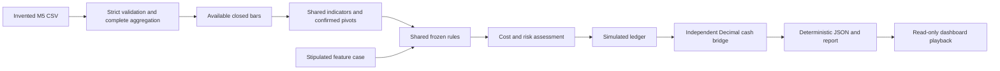

# Architecture

`bbp_system` contains the selected newer numerical/causal engine. `bbp_demo` supplies the invented raw data, explicit engineered case, evidence labels, offline report and playback boundary. There are no MT5 imports or live-adapter commands in the selected execution path.

The raw pipeline calculates features from each timeframe's completed candles. The engineered feature case separately supplies stipulated `FrameFeatures` to isolate rules and accounting. Both exercise the same decision/ledger core; the report never treats their results as the same experiment.

The dashboard reads a completed immutable report. Playback reveals OHLC only at availability time, with decisions and cost/risk reasons attached. It cannot alter configuration, reserve a position or submit an order. Its HTTP route uses no arbitrary filesystem paths.

The persistent `PaperLedger` remains for atomic write/restart and risk regression tests. The report uses its in-memory adapter, which has no runtime account file. Local transient test state is outside the tracked tree.
